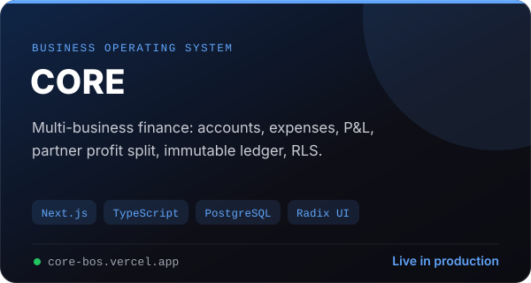

<p align="center">
  
</p>

<p align="center">
  <a href="https://core-bos.vercel.app"></a>
  
  
  
</p>

# CORE — Business Operating System

**One platform. Every business. Complete control.**

CORE lets one owner run the finances and operations of several businesses from a single dashboard. Partners get read-only access to only the businesses they belong to, profit is shared automatically, and every money movement is recorded in a ledger that can never be edited or deleted.

## ✨ Features

**Businesses & partners**
- Owner creates, edits, archives and restores businesses
- Partners join only through a private invite link — 7-day expiry, single use, email must match
- Partners are read-only and see only their own businesses, **enforced in the database with Postgres Row-Level Security**
- Profit split per business, effective-dated so history never changes, and always totalling 100%
- Tamper-proof activity log for every business

**Finance**
- Accounts (Cash, bKash, Nagad, Bank…) with live balances and transfers
- Expenses with custom categories, plus a dedicated advertising / boosting view by platform, campaign and product
- Partner investments and withdrawals — an expense a partner pays personally becomes their capital contribution automatically
- **Immutable ledger**: entries are never edited or deleted; corrections are reversals with a reason
- Profit & loss, settlements, transactions and dashboards with date ranges, charts and CSV export

**Operations**
- Products, customers and orders, including orders received from websites through a secure webhook
- Generated PDF documents
- Email notifications and a weekly scheduled report
- Bangla / English toggle, light / dark themes and a mobile-friendly layout

## 🛠️ Tech stack

| Layer | Technology |
| --- | --- |
| Framework | Next.js 15 (App Router), React 19 |
| Language | TypeScript |
| Database & auth | Supabase — PostgreSQL, Row-Level Security, SQL migrations and tests |
| UI | shadcn/ui pattern on Radix primitives, Tailwind CSS v4, Lucide icons |
| Data | Recharts, TanStack Table |
| Documents & email | Puppeteer (PDF), Nodemailer (SMTP) |
| Hosting | Vercel (with a scheduled weekly job) |

Fonts: Inter + Noto Sans Bengali.

## 🚀 Setup

1. **Database** — in Supabase → SQL Editor, run the files in `supabase/migrations/` in order (`0001` → latest).
2. **Owner account** — create your user in Authentication → Users, then make it the owner:
   ```sql
   insert into public.platform_owners (user_id)
   select id from auth.users where email = 'you@example.com';
   ```
3. **Environment variables** (Vercel → Settings → Environment Variables, see `.env.example`):

   | Variable | Purpose |
   | --- | --- |
   | `NEXT_PUBLIC_SUPABASE_URL`, `NEXT_PUBLIC_SUPABASE_PUBLISHABLE_KEY` | Supabase project |
   | `NEXT_PUBLIC_SITE_URL` | Live site address, used in email and invite links |
   | `SMTP_HOST`, `SMTP_PORT`, `SMTP_USER`, `SMTP_PASS`, `MAIL_FROM`, `MAIL_FROM_NAME` | Outgoing email |
   | `CRON_SECRET` | Protects the weekly scheduled job |

4. **Auth redirects** — in Supabase → Authentication → URL Configuration, set the Site URL to your live URL and add `https://YOUR-URL/auth/callback` to Redirect URLs.

## 💻 Develop

```bash
npm install
npm run dev      # http://localhost:3000
npm run build
```

## 🧪 Tests

Database security tests live in `supabase/tests/` — run them with `psql` against a Supabase-compatible database.

---

<p align="center">Built by <a href="https://github.com/Borhan-Dipto">Borhan Dipto</a></p>
